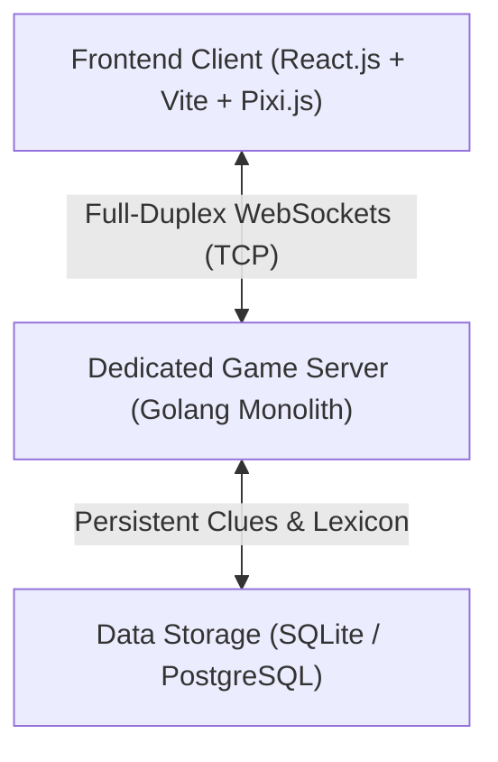
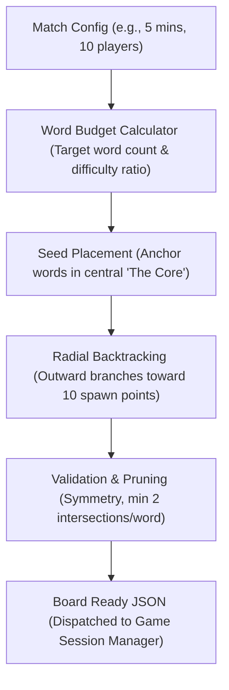
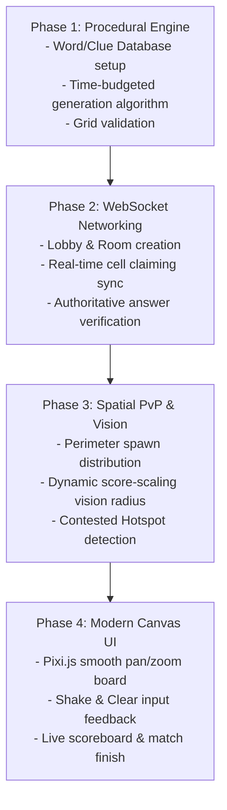

# Multiplayer Strategic Crossword: MVP Technical Architecture Blueprint

> **Companion Document:** [game_rules.md](file:///Users/moecods/.gemini/antigravity/brain/ddbb0f4f-bd85-43b4-8e4d-235093cbca18/game_rules.md)  
> **Target:** Scalable MVP supporting 2–10 players with real-time sync (<100ms) and procedural generation.

---

## 1. System Overview & Tech Stack Architecture



### Technology Stack Specifications

| Layer | Technology | Primary Role & Rationale |
| :--- | :--- | :--- |
| **Frontend Framework** | **React.js + Vite** | Lightweight Single Page Application (SPA). Zero SSR overhead, instant hot-reload, and handles HUD UI (timers, scores, input overlays). |
| **Board Render Engine** | **Pixi.js (WebGL Canvas)** | GPU-accelerated 2D viewport rendering. Handles real-time board interaction, smooth pan/zoom, and dynamic visual effects. |
| **Backend Game Server** | **Golang** | Compiled high-concurrency game server. Manages persistent WebSocket connections with native goroutines, low-latency in-memory state, and sub-second backtracking crossword generation. |
| **Networking Protocol** | **Native WebSockets** | Event-driven, low-overhead bidirectional transport (<50ms latency) using `gorilla/websocket` or `nhooyr.io/websocket`. |
| **Database** | **SQLite / PostgreSQL** | Storage of the curated word bank, clue metadata, difficulty classifications, and estimated solve times. |

---

## 2. Procedural Crossword Generator Engine

The generator produces an infinite variety of unique boards tailored to match duration and player count.



### Lexicon Data Schema
```json
{
  "id": "clue_10482",
  "word": "GALAXY",
  "clue": "A massive gravitational system of stars and dark matter",
  "length": 6,
  "difficulty": "medium",      // "easy" (1x), "medium" (2x), "hard" (3x)
  "estimated_solve_sec": 18,   // Used by Time-Budgeted Generator
  "category": "Science"
}
```

---

## 3. Real-Time WebSocket Event Protocols

To keep 10 players synchronized with zero latency and absolute anti-cheat integrity, the server is **100% authoritative**.

### A. Client ──► Server Events

| Event Name | Payload | Purpose |
| :--- | :--- | :--- |
| `SUBMIT_GUESS` | `{ roomId, wordId, answer, clientTimestamp }` | Player attempts to solve a word in their vision radius. |
| `PING_VIEWPORT` | `{ roomId, focusCellId }` | Updates where the player is currently looking (for soft halos). |

### B. Server ──► Client Broadcast Events

| Event Name | Payload | Purpose |
| :--- | :--- | :--- |
| `WORD_CLAIMED` | `{ wordId, claimedBy, newlyClaimedCells: [ { x, y, letter, ownerColor } ], newScores: { ... } }` | Instant broadcast when someone solves a word. All 10 screens update letters & territory. |
| `RADIUS_EXPANDED`| `{ playerId, newRadius }` | Notifies that a player's vision circle has grown. |
| `CONTESTED_HOTSPOT`| `{ wordId, overlappingPlayers: [ 'p1', 'p3' ] }` | Triggers the visual "Rivalry Pulse" on clues seen by multiple players. |
| `GUESS_RESULT` | `{ wordId, success: false, reason: "incorrect" }` | Sent **privately** to the submitter to trigger the 0.5s Shake & Clear animation. |
| `MATCH_ENDED` | `{ finalScores: [ ... ], winner: "p4", fullBoard: { ... } }` | Triggered by timer or 90% board completion. |

---

## 4. Authoritative Match State Schema (Redis)

```json
{
  "roomId": "ARENA-9021",
  "status": "IN_PROGRESS",
  "timeRemaining": 242,
  "totalCells": 480,
  "claimedCells": 210,
  "players": {
    "p1": {
      "name": "Sina",
      "color": "#FF4444",
      "score": 42,
      "visionRadius": 4,
      "spawnPoint": { "x": 0, "y": 12 }
    }
  },
  "gridState": [
    // Array of cells: { x, y, letter, owner: "p1" | null, isIntersection: true }
  ]
}
```

---

## 5. Phased MVP Implementation Roadmap


